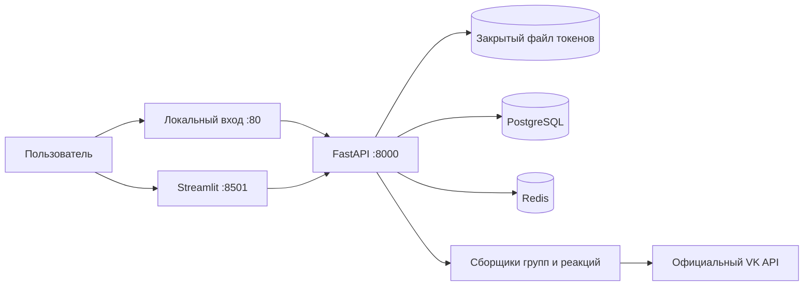

# Инструкции и техническая карта проекта

## Назначение и границы

Учебный проект старшей школы: по теме поиска показать статистику найденной аудитории VK.
Пользователь работает через Streamlit; FastAPI собирает данные через официальный API,
сохраняет текущие профили и связи в PostgreSQL и строит агрегаты. Redis ускоряет поиск
готового результата и подсказок. Главный приоритет — понятный код и честные ограничения данных.

MVP включает участников найденных сообществ, лайки и репосты найденных постов;
сценарии можно объединять. Общий размер — число уникальных доступных профилей в выборке,
а не оценка всех интересующихся темой пользователей VK и не рекламный охват.
Загрузка сегмента в рекламный кабинет, размещение рекламы, комментарии и LLM пока не реализованы.

## Рабочие правила

- Агентные планы, решения, ограничения и будущие заметки вести в этом единственном AGENTS.md.
  Не создавать дополнительные TODO.md, PLAN.md, исследовательские отчёты и подобные файлы.
  README.md предназначен людям: простые объяснения, запуск, ограничения и план развития.
- Писать просто: небольшие функции и классы по назначению, без очередей, микросервисов
  и дополнительных абстракций без конкретной необходимости.
- Автор коммитов только для этого репозитория: `esbulgakova <bulgakovae353@gmail.com>`.
  Пользователь разрешил локальные ветки, коммиты и слияние готовой работы в main.
  Не менять глобальный Git-профиль. Наличие remote не означает проверенный доступ к push.
- Не выводить токены, пароли, содержимое .env, полные VK error payload или HTTP request bodies.
  Не коммитить .env, данные БД, виртуальные окружения, логи с профилями и ключами.
- Использовать только разрешённые VK данные. Не обходить закрытые профили/сообщества,
  CAPTCHA, ограничения API и не заменять отказ скрейпингом сайта или чужим токеном.
- Сохранять только признаки MVP: ID, имя, фамилию, пол, дату рождения, город, страну,
  регион, время обновления и происхождение попадания в выборку. Не сохранять весь JSON
  профиля, контакты, религию, политические взгляды и другие ненужные личные признаки.
- API дашборда возвращает агрегаты и сообщества, а не список людей с профилями.
- Для внутренних сервисов рабочего контура Яндекса (wiki.yandex-team.ru, Nirvana,
  Reactor, YT, Arcanum и других) не использовать браузер: пользователь сообщил,
  что доступ через браузер агента не работает. Использовать подключённые MCP,
  официальные API или CLI. Сначала проверить настроенные инструменты и учётные данные
  нужного сервиса; не просить входить через браузер агента. Секреты не выводить.
  При отсутствии прямого доступа сообщить конкретный блокер.

## План работы и порядок будущих изменений

1. Прочитать этот файл и README, проверить состояние репозитория и существующие изменения.
2. При изменении интеграции сверить официальный интерфейс VK и возможность доступа;
   различать спецификацию метода и успешный вызов с конкретным токеном.
3. Уточнить контракт `Collection` и ответ API до изменения фронтенда/хранилища.
4. Реализовать сбор с пагинацией, лимитами, дедупликацией и понятными ошибками.
5. Сохранить данные атомарно; проверить обновление профилей и замену связей запроса.
6. Построить статистику из БД; неизвестные признаки оставить отдельной категорией.
7. Подключить UI без повторного сбора при переключении вида диаграммы или карты.
8. Выполнить относящиеся к изменению тесты; реальные PostgreSQL/Redis проверять отдельно.
9. Обновить README и этот файл по итоговому поведению. Указать непроверенные зависимости
   от внешнего доступа. Не объявлять Docker/VK-интеграцию работающей по одним mock-тестам.

## Архитектура и карта кода



| Файл | Ответственность |
|---|---|
| `backend/app/main.py` | Фабрика FastAPI, валидация запроса, маршруты, безопасные ошибки |
| `backend/app/config.py` | Настройки окружения, локальные адреса входа, лимиты, ключ политики сбора |
| `backend/app/auth.py`, `auth_pages.py` | VK ID: браузерный PKCE, callback, файл ключей, одноразовое обновление |
| `backend/app/vk.py` | HTTP POST, ограничение частоты, повторы, срок ожидания, проверка ответа |
| `backend/app/collectors.py` | Контракт Collection, три сценария, профили/гео, демоданные |
| `backend/app/service.py` | Нормализация, свежесть, блокировка, upsert, замена связей, дашборд |
| `backend/app/models.py` | SQLAlchemy-таблицы и внешние ключи |
| `backend/app/database.py` | Подключение, создание схемы, включение FK в SQLite-тестах |
| `backend/app/analytics.py` | Возраст, распределения, доли и покрытие признаков |
| `backend/app/cache.py` | Redis с безопасным отказом; ключи подсказок |
| `frontend/app.py` | Поиск, сценарии, подсказки, метрики, диаграммы, карта/таблица |
| `frontend/geo.py` | Точное сопоставление регионов и карта Plotly без внешних тайлов |
| `frontend/data/regions.geojson` | Подготовленные границы регионов и сведения об источнике |
| `compose.yaml` | Четыре основных сервиса и отдельный тестовый профиль |
| `tests/` | Существенные проверки API, БД, сборщика, статистики и географии |

## Контракты и выполнение поиска

- `GET /health`: доступность БД, режим данных, состояние Redis.
  Отказ Redis не делает PostgreSQL-результат недействительным.
- `GET /api/suggestions?q=...`: до восьми уникальных ранее собранных тем по префиксу;
  источником служит БД, Redis хранит список 30 секунд. Это подсказки поискового ввода.
- `POST /api/search`: `{"query":"фотография","modes":["groups","likes","reposts"],"data_mode":"demo"}`.
  `data_mode=demo/vk` выбирается в UI; без поля используется DATA_MODE из окружения.
  `/api/suggestions` принимает такой же необязательный query-параметр.
  Нужен минимум один сценарий; тема после нормализации имеет длину 2–200 символов.
- Ответ: тема/режимы, `collected_at`, `expires_at`, `cache_hit`, `limited`, `complete`,
  `warnings`, `total_users`, распределения `gender`, `age`, `geography`, `coverage`,
  справочник найденных `groups` и количества уникальных пользователей по `sources`.
- 409 означает уже выполняющийся сбор; 502 — безопасную ошибку сборщика/VK;
  503 — ошибку БД; 422 — невалидный запрос. Сообщения не должны содержать секреты.
- `Collection.users` — словарь ID → разрешённые поля профиля; `groups` — ID → сообщество;
  `memberships` — множество `(group_id,user_id)`; `evidence` — `(user_id,source,source_id)`.
  `source_id` для группы — её ID, для реакции — строка `owner_id_post_id`.
- `complete=False` означает сбой части сбора. `limited=True` означает ограниченный
  объём выборки; это не обязательно технический сбой. Успешный пустой ответ допустим.
- Сначала собираются ID, затем `users.get` получает профили пакетами до 1000.
  Деактивированные и закрытые профили исключаются, отрицательные ID не считаются людьми.
  Пользователь из нескольких источников учитывается один раз в общем размере;
  количества по источникам пересекаются, их нельзя складывать как уникальную аудиторию.
- Streamlit хранит ответ в session state. Переключение диаграммы/карты использует этот
  ответ и не запускает новый POST. Новый сбор запускается кнопкой поиска.

## Реляционная модель и обновление

| Таблица | Ключ и назначение |
|---|---|
| `users` | PK `(mode,id)`, последняя информация о профиле |
| `communities` | PK `(mode,id)`, последняя информация о сообществе |
| `searches` | PK `id`, уникальный `key`, тема/режимы/время сбора/срок/предупреждения |
| `search_users` | PK `(search_id,user_id)`, FK к поиску и `(mode,user_id)` к users |
| `search_communities` | PK `(search_id,group_id)`, FK к поиску и `(mode,group_id)` к communities |
| `memberships` | PK `(search_id,group_id,user_id)`, FK к обеим связующим таблицам |
| `evidence` | Уникальность `(search_id,user_id,source,source_id)`, FK к search_users |

- `mode=demo/vk` входит в ключи профилей и сообществ: вымышленные данные не перезаписывают реальные.
- Для успешного обновления upsert заменяет известные признаки текущими; отсутствующее
  в новом разрешённом профиле поле очищается, а не сохраняет старое значение бессрочно.
- В одной транзакции обновляются профили/сообщества и целиком заменяются связи этого
  запроса. Удаляются сначала memberships/evidence, затем связующие строки; вставка
  идёт от родителей к детям. Связи других запросов сохраняются.
- Нет истории версий профилей и снимков: в БД хранится текущая строка профиля и одна
  выборка на ключ запроса. Новые люди добавляются, повторные ID не размножаются.
- Профиль общий для запросов одного режима: новое наблюдение в теме B может обновить
  его признаки в дашборде темы A. `collected_at` обозначает время сбора состава темы,
  а не отдельный неизменяемый снимок каждого признака.
- При полном сбое сборщик выбрасывает CollectionError; транзакция не заменяет старую выборку.
- При неполном обновлении существующей полной выборки сервис ничего не перезаписывает:
  возвращает прежний дашборд с `complete=False`, старой датой и предупреждением.
  Срок свежести не продлевается, следующий поиск повторяет попытку обновления.
- Первый неполный результат можно сохранить и показать, но его TTL равен нулю.
  Ограниченная лимитами, но технически успешная выборка может иметь обычный TTL.
- `create_all` создаёт отсутствующие таблицы, но не мигрирует существующие колонки.
  При развитии схемы подготовить явную миграцию; не удалять пользовательский volume для удобства.

## Свежесть, кэш и конкурентный доступ

- Нормализация: Unicode NFKC → casefold → `ё` в `е` → схлопывание пробелов.
  « ФОТОГРАФИЯ » и «фотография» совпадают. Синонимы и разные словоформы пока не объединяются.
- Ключ поиска: SHA-256 от нормализованной темы, отсортированного множества сценариев,
  режима demo/vk и `policy_key`. Последний учитывает лимиты, окно постов, версию VK API
  и номер схемы политики. Секрет токена в ключ не включать.
- По умолчанию данные свежие 86400 секунд от завершения сбора, а не до полуночи.
  Свежесть каждый раз проверяется по `searches.expires_at` в PostgreSQL.
- Redis хранит соответствие ключ → ID поиска, не готовый дашборд. Очистка Redis
  не вызывает новый VK-сбор, если выборка в БД ещё свежая. Агрегаты строятся из БД.
- Значение, дата или наличие ключа в Redis не заменяют проверку БД.
- Один Uvicorn worker. В процессе действует неблокирующий threading.Lock, а в PostgreSQL
  — `pg_try_advisory_xact_lock(724191854)` на время всей транзакции сбора.
  Это защищает от одновременно начатых сборов и лишних обращений к VK.
  Уже свежие результаты можно читать во время другого сбора.
- Не увеличивать число workers/реплик без отдельного решения по общей квоте VK,
  блокировкам и длительным запросам. В MVP нет фоновой очереди и сохранённых заданий.

## VK API: проверенные факты и границы проверки

Первичное исследование 1 ноября 2026 опиралось на VKCOM/vk-api-schema 5.199,
commit `333481bd082ad747d4873ef4a77f9247097eeef0` от 14 апреля 2025: сайт документации
тогда не открывался. Позднее 1 ноября 2026 страницы `dev.vk.ru` и документацию VK ID
удалось скачать напрямую. Следующие уточнения по текущим страницам имеют приоритет
над старой схемой. Прочитанная документация всё ещё не заменяет реального вызова:
получение пользовательского токена и доступ конкретного приложения пока не проверены.

| Метод | Тип ключа и границы: схема с уточнениями текущих страниц | Применение |
|---|---|---|
| `groups.search` | user; count ≤1000, доступны первые 1000 результатов | Открытые сообщества среди первых MAX_GROUPS результатов |
| `groups.getMembers` | user/group/service; count ≤1000, offset | Участники, размер группы из response.count |
| `users.get` | user/group/service; ≤1000 user_ids | Разрешённые признаки найденных людей |
| `newsfeed.search` | user/service; count ≤200 по схеме, start_from/next_from; текущая страница ограничивает выдачу первыми 1000 | Посты в явном временном окне |
| `likes.getList` | user/service; count ≤1000 без friends_only, offset; copies требует прав редактора/администратора или владельца стены | ID лайкнувших и доступные репосты |
| `database.getCities` | user/service по текущей странице; count ≤1000, q ≤15 символов; текст region/area | Попытка уточнить регион с точным совпадением city_id |
| `database.getCitiesById` | user/service; ≤1000 city_ids; id,title | НЕ источник гарантированных региона/координат |
| `wall.getReposts` | user/service; count ≤1000; posts/profiles/groups | Изученная альтернатива; в MVP не вызывается |
| `wall.search` | user/service; domain/query, count ≤100 | Будущий поиск на заданной стене |
| `wall.getComments` | user/service; count ≤100; отдельная пагинация веток | План развития |

- Для likes.getList у группы `owner_id` отрицательный. Это ID владельца записи,
  а не знак пользовательских ID в результирующей аудитории.
- В newsfeed.search явное окно определяется POST_SEARCH_DAYS; дефолт VK без start_time
  по схеме — 24 часа. Повторяющийся курсор/страница останавливает обход с предупреждением.
- Структура ответа проверяется: неожиданный JSON не должен превращаться в успешную пустую аудиторию.
- VkClient передаёт ключ в Authorization: Bearer, параметры — в теле POST, ключа нет в URL.
  Использует общий интервал 0.36 секунды,
  максимум три попытки для временных сетевых ошибок/429/5xx/кодов 6 и 10, общий deadline сбора.
  Это собственные настройки MVP, а не гарантия действующих квот VK.
- Ошибки прав/авторизации, CAPTCHA и исчерпание лимита не обходятся. Сообщение создаётся
  локально: raw error_msg/request_params могут содержать токен. Не логировать их.
- `filter=copies` в likes.getList доступен только редактору/администратору сообщества
  либо владельцу личной стены. Репосты произвольных найденных постов не гарантированы;
  проверить ошибки/неполный ответ и не интерпретировать недоступный список как нулевую аудиторию.
- Для серверного пользовательского токена современная документация направляет в VK ID.
  Создать собственное Web-приложение в кабинете `https://id.vk.ru/about/business/go/`;
  нужны профиль бизнеса и подтверждение по текущим правилам. Неподтверждённый профиль
  ограничивает настройки/ключи; документация указывает блокировку через 60 дней от первого приложения.
  `client_id`, защищённый ключ и сервисный ключ из настроек не являются пользовательским Access token.
- Локальная настройка подтверждена документацией: базовый домен `localhost`, доверенный
  redirect URL `http://localhost` без порта, обработчик на 80; вариант HTTPS —
  `https://localhost` на 443. Другие порты временно не поддерживаются.
  Compose публикует тот же backend также на 127.0.0.1:80; callback — GET /.
  Существующие API 8000/UI 8501 сохраняются. HTTPS в текущем Compose не настроен.
- Современный VK ID flow использует `id.vk.ru/authorize`, код, PKCE S256, проверку state
  и обмен кода с device_id через `id.vk.ru/oauth2/auth`; затем обновление через Refresh token.
  Не путать этот flow с прежним `oauth.vk.com`: старые пользовательские Implicit Flow
  и Authorization Code Flow отключены 25.06.2024. Ранее выданные бессрочные ключи остаются
  действительными, если не отозваны; это не способ получить новый постоянный ключ.
- Современный Access token действует 1 час. С 2 ноября реализованы вход, callback и Refresh token
  для конфиденциального приложения. Реальное подключение пользователя ещё требует проверки.
  Статический VK_TOKEN поддержан отдельно; для него нет автоматического продления.
- Базовый scope — `vkid.personal_info`; он не доказывает доступ ко всем методам поиска.
  Не объявлять `groups`, `wall`, `offline` обязательным набором для MVP: текущая документация
  различает базовые права VK ID, ранее выданные права и индивидуально согласуемые расширенные права.
  Проверить `groups.search` и остальные методы конкретным токеном; при отказе уточнять доступ у VK.
  Не использовать чужие app_id и сторонние генераторы токенов.

## Авторизация VK ID: реализация 2 ноября 2026

- ID собственного приложения задаётся VK_APP_ID. Сервисный ключ пользователь вводит в UI
  или VK_SERVICE_TOKEN. Конфиденциальный тип и внешний исходящий IP настраиваются в кабинете VK.
  client_secret не используется. Публичный frontend exchange не реализован.
- GET /api/vk/status возвращает только статус, ID аккаунта/приложения, время и login_url.
  POST /api/vk/configure сохраняет service_token; POST /api/vk/disconnect удаляет подключение.
  POST /api/vk/check проверяет groups.search(count=1), не собирая аудиторию.
  Управляющие POST требуют X-Requested-With: AudienceDashboard и проверяют Origin при его наличии;
  CORS не разрешён, допустимые Host ограничены localhost/127.0.0.1/backend/testserver.
- GET /auth/vk/start создаёт ограниченную по времени попытку и HttpOnly SameSite=Lax cookie.
  JS на локальной странице создаёт PKCE verifier/challenge. POST /auth/vk/prepare привязывает
  их к cookie; state случайный и одноразовый. Попытки живут 600 секунд только в памяти,
  перезапуск backend требует начать вход заново. Внешние скрипты/изображения не используются.
- GET / принимает прямые code/state/device_id либо JSON payload; неоднозначные/повторяющиеся
  параметры отклоняются. Проверяются cookie/state/время, затем выполняется обмен кода.
  Ответ API обязан вернуть ожидаемый state, корректные токены, срок и ID пользователя.
  При успехе — redirect на фиксированный UI с vk_login=success; UI проверяет настоящий статус,
  а не доверяет параметру URL. Access/Refresh token и id_token никогда не возвращаются UI.
- Файл /app/state/vk-auth.json хранит сервисный ключ и текущую пару токенов, device_id и сроки;
  id_token не хранится. Запись атомарная через tempfile+fsync+replace, файл 0600 / каталог 0700.
  Файл находится в отдельном named volume vk_auth_data, не в коде/Git/Redis/образе.
  Это закрытый локальный файл, не шифрование на диске; Docker-администратор может его прочитать.
  Смена appID/redirect не переиспользует прежние ключи.
- Access token обновляется при обращении к VK за 60 секунд до истечения либо один раз после
  VK error5. Refresh token одноразовый (срок 180 дней): обновление сериализовано RLock;
  перед HTTP-запросом на диск пишется refresh_in_flight. При сбое/неясном исходе или перезапуске
  со флагом старый refresh не используется повторно, требуется новый вход. HTTP refresh не ретраится.
- connection_lock не позволяет заменить/отключить аккаунт во время сбора; изменение подключения
  при занятой блокировке отвечает 409. Демоданные всегда доступны отдельно.
  После OAuth-ошибки/отключения нет скрытого возврата к устаревшему VK_TOKEN.
  Выборки и подсказки разделены по подключению: OAuth appID/userID, ручной ключ — SHA256
  высокоэнтропийного VK_TOKEN (сырой ключ не входит в кэш/БД/статус). В details выборки
  хранится credential_partition; прежние VK-темы без него в новых подсказках не появляются.
- Uvicorn запущен с --no-access-log, чтобы callback-коды не попадали в журналы URL.
  Ошибки VK преобразуются в безопасные тексты без raw response/request bodies.
- Это подключение одного локального оператора, не система входа посетителей в дашборд.
  Не публиковать контейнеры в интернет без отдельной пользовательской авторизации.

## География и достоверность диаграмм

- У `users.city` гарантирована только пара id/title. `country` отсутствует и в enum
  схемы 2025, и в списке fields на прочитанной 01.11.2026 странице users.get; старое
  текстовое описание в схеме его ещё упоминало. Сборщик запрашивает country и при ошибке 100
  повторяет users.get без него; неизвестные страны остаются неизвестными.
- `country_id` отсутствует и в схеме, и на текущей странице database.getCities; код
  передаёт его для совместимости со старым интерфейсом. Нужна живая проверка этого параметра.
  Текущая страница ограничивает q до 15 символов, а код отправляет полное название города:
  следующий шаг — проверить длинные названия и ограничить поисковый префикс, сохранив точное
  сравнение city_id. В этом ходе код не менялся. По одному названию регион не назначать.
- Не обещать полную карту по профилям. Неизвестные страны/регионы остаются в таблице.
  Покрытие города (`coverage.geography`) и доля, сопоставленная с картой областей, различаются.
- Карта использует локальный Natural Earth admin-1 GeoJSON; источник/лицензия записаны
  в его metadata. Это схематические границы из источника, а не сервис актуальных границ.
- Поддержан набор RU/BY/UA/KZ/KG/UZ/TJ/TM/MD/AM/AZ/GE; его нельзя называть точным текущим
  юридическим составом СНГ. Географическое покрытие включает соседние страны.
- Регион сопоставляется только по точному нормализованному алиасу. Без страны допустим
  лишь единственный однозначный регион; явная другая страна не игнорируется.
  Город используется как регион только для соответствующей административной единицы
  типа City/Independent City/Federal City при известной стране. Не назначать столицу неизвестным людям.
- Пол: 0/отсутствие → «Не указан», 1 → женский, 2 → мужской. Без года рождения
  возраст неизвестен; невозможные даты/возраст вне 0–110 также неизвестны.
  Проценты считаются от всей выборки, включая неизвестные значения; округление допустимо.

## Проверки и локальный запуск

Основной путь из корня репозитория (Python в контейнерах 3.12):

```bash
cp .env.example .env
docker compose up --build -d
docker compose ps
docker compose logs --tail=100 backend frontend
docker compose down
```

UI: http://localhost:8501, документация API: http://localhost:8000/docs.
Порты опубликованы только на 127.0.0.1; PostgreSQL/Redis наружу не опубликованы.
`docker compose down` сохраняет БД; `down -v` удаляет данные и требует осознанного решения.

```bash
python3.12 -m venv .venv
.venv/bin/python -m pip install -r requirements-dev.txt
.venv/bin/python -m pytest -q -m "not integration"
.venv/bin/python -m ruff check backend frontend tests
docker compose --profile test run --build --rm tests
```

Тестовый Compose поднимает отдельные postgres-test/redis-test, не рабочую БД.
Интеграционный тест создаёт уникальную схему PostgreSQL и удаляет только её.
Без TEST_DATABASE_URL и TEST_REDIS_URL реальная интеграция пропускается — skip не равен pass.
Текущая локальная среда разработки агента также может использовать `.venv312` вместо `.venv`.

Проверять важные инварианты: 24 часа и Redis outage; нормализацию; разделение режимов/
сценариев/политик; upsert и замену связей; сохранение полной выборки при сбое;
дедупликацию; неизвестные возраст/гео; токен вне URL/ошибок; пагинацию и квоты;
один сбор; переключение графика без нового POST. Не добавлять тесты ради снимков оформления.
Не считать наличие этих команд доказательством выполненного Docker, PostgreSQL или живого VK теста.

## Итог проверок 1 ноября 2026

- Полный Docker Compose-контур собран и запущен на macOS Apple Silicon:
  Docker Desktop 4.97.0, Engine 29.9.2, Compose 5.6.1, контекст `desktop-linux`.
  Отдельная установка Compose не потребовалась — он входит в Desktop.
- Пользовательские ссылки Docker уже находились в `~/.docker/bin`. В `~/.zshrc`
  добавлен этот каталог в PATH; новый интерактивный zsh находит `docker` и `docker compose`.
  Не менять глобальные настройки Docker или SSH ради этого проекта без необходимости.
- Создан локальный `.env` из примера в demo-режиме; файл исключён из Git и Docker-контекста.
  Не перезаписывать его при будущих запусках, если пользователь уже добавил настройки/токен.
- `docker compose up --build -d --wait --wait-timeout 180` завершился успешно.
  Backend, frontend, postgres и redis имеют статус healthy; наружу опубликованы только
  127.0.0.1:8000 и 127.0.0.1:8501. Проверены HTTP 200 для UI, его health, API health и /docs.
- В контейнерах используются PostgreSQL 16.15 и Redis 7.4.12.
- Тестовый образ собран через `docker compose --profile test build tests`.
  `docker compose --profile test run --rm tests`: **51 passed, без пропусков**.
  Интеграция использовала отдельные postgres-test/redis-test; рабочая БД не очищалась.
  `docker compose --profile test run --rm --no-deps tests ruff check .`: без замечаний.
  Одно предупреждение о deprecated alias в зависимости Starlette/AnyIO не влияет на результат.
- Live smoke из frontend-контейнера проверил настоящий API и Streamlit AppTest:
  165 демопрофилей в трёх сценариях, суммы распределений, повторный нормализованный запрос
  без нового сбора, подсказки, три диаграммы, таблицу и отсутствие повторного POST при переключениях.
- Тестовые PostgreSQL/Redis после проверки остановлены. Четыре рабочих сервиса оставлены
  запущенными для пользователя. Никакие пользовательские volumes не удалялись.
- Скриншот в браузере не получен: CUA вернул `apps=[]`, `browsers=[]`.
  HTTP/AppTest-проверка не является визуальной проверкой браузерного рендера.
- GitHub SSH-доступ настроен и проверен как esbulgakova: origin использует SSH,
  конкретный ключ выбран через локальный `core.sshCommand`. Коммит MVP c77b125
  ранее успешно отправлен в main. Закрытый ключ не хранить в репозитории и не выводить.
- Живые вызовы VK с пользовательским токеном не проверены; демоданные не подтверждают доступ к API.

## Итог подключения VK ID 2 ноября 2026

- Пользователь подтвердил ID приложения 54871270 и доступность ключей после подтверждения профиля.
  ID записан только в локальный .env; сервисный ключ пользователь вводит в UI, в чат он не передавался.
- Реализованы auth.py/auth_pages.py, подключение token provider к VkClient, отдельные demo/vk
  сервисы, выбор режима и настройка VK в Streamlit. Токены не хранятся в Redis или профилях БД.
- Docker backend/frontend/tests собраны; четыре основных контейнера healthy.
  Порт 80 опубликован только на 127.0.0.1; GET / возвращает303 на localhost:8501.
- Полный запуск docker compose --profile test run --rm tests: **83 passed, без пропусков**;
  есть одно прежнее предупреждение Starlette/AnyIO. Ruff прошёл.
- При живой проверке найден лишний пробел в конце CSP без nonce: h11 отклонял ответ.
  Исправлено .rstrip(); добавлен тест через h11.Response (ASGI TestClient сам это не ловит).
  Повторные HTTP-запросы и браузер подтвердили устранение ошибки.
- Live smoke: /api/vk/status — 200 и правильный appID без секретов, 165 demo-профилей,
  нормализованный повтор использует кэш, VK-поиск до входа — 401, callback — 303.
- Браузер стал доступен: открыта и осмотрена панель на localhost:8501, настройки раскрыты.
  Снимок вне репозитория /private/tmp/vk-connection-ready.png. Прежний блокер CUA относится к 1 ноября.
- Реальный OAuth ещё не выполнен: нужен сервисный ключ, конфиденциальный тип и разрешённый
  исходящий IP в VK. Mock-тесты не подтверждают живую выдачу токенов или доступ к groups.search.

## План развития

1. Проверить реальный вход через реализованный VK ID flow, обновление и права своего приложения;
   выполнить небольшой поиск, проверить ограничение copies и географию. Фиксировать ошибки без секретов.
2. Добавить поиск внутри выбранных сообществ и расширить прозрачные показатели покрытия.
3. Разбирать комментарии/ветки через wall.getComments; хранить только нужные признаки,
   учитывать контекст, отрицания и неоднозначность интереса.
4. Предлагать LLM-расширение темы: варианты запроса показывать пользователю; не отправлять
   в модель профили и контакты. Ключ кэша должен учитывать утверждённые запросы и версию политики.
5. Отдельно спроектировать законное создание рекламных сегментов через поддерживаемый
   рекламный API и его разрешения. Нынешний дашборд не является готовым сегментом кабинета.
6. При росте нагрузки добавить миграции, задания со статусом, аутентификацию и политику
   удаления данных; не вводить эти компоненты заранее ради архитектурной сложности.

## Первичные источники

- [VK API schema и версия](https://github.com/VKCOM/vk-api-schema).
- [Методы групп](https://github.com/VKCOM/vk-api-schema/blob/333481bd082ad747d4873ef4a77f9247097eeef0/groups/methods.json).
- [Поиск постов](https://github.com/VKCOM/vk-api-schema/blob/333481bd082ad747d4873ef4a77f9247097eeef0/newsfeed/methods.json).
- [Лайки и filter=copies](https://github.com/VKCOM/vk-api-schema/blob/333481bd082ad747d4873ef4a77f9247097eeef0/likes/methods.json).
- [Стена и комментарии](https://github.com/VKCOM/vk-api-schema/blob/333481bd082ad747d4873ef4a77f9247097eeef0/wall/methods.json).
- [Поля профиля](https://github.com/VKCOM/vk-api-schema/blob/333481bd082ad747d4873ef4a77f9247097eeef0/users/objects.json).
- [Методы географии](https://github.com/VKCOM/vk-api-schema/blob/333481bd082ad747d4873ef4a77f9247097eeef0/database/methods.json), [ответы](https://github.com/VKCOM/vk-api-schema/blob/333481bd082ad747d4873ef4a77f9247097eeef0/database/responses.json), [объекты](https://github.com/VKCOM/vk-api-schema/blob/333481bd082ad747d4873ef4a77f9247097eeef0/database/objects.json).
- [Коды ошибок](https://github.com/VKCOM/vk-api-schema/blob/333481bd082ad747d4873ef4a77f9247097eeef0/errors.json).
- [Официальный VK ID SDK](https://github.com/VKCOM/vkid-web-sdk) и [создание приложения](https://id.vk.ru/about/business/go/docs/ru/vkid/latest/vk-id/connection/create-application).
- [Актуальные типы/сроки ключей и отключённые способы](https://dev.vk.ru/ru/api/access-token/getting-started), [пользовательский токен](https://dev.vk.ru/ru/api/access-token/user-token).
- [Современная авторизация Web с PKCE](https://id.vk.ru/about/business/go/docs/ru/vkid/latest/vk-id/connection/start-integration/how-auth-works/auth-flow-web), [базовые scopes](https://id.vk.ru/about/business/go/docs/ru/vkid/latest/vk-id/connection/work-with-user-info/scopes), [права VK API](https://dev.vk.ru/ru/reference/access-rights).
- [Текущие ограничения likes.getList/copies](https://dev.vk.ru/ru/method/likes.getList), [database.getCities](https://dev.vk.ru/ru/method/database.getCities), [users.get](https://dev.vk.ru/ru/method/users.get), [newsfeed.search](https://dev.vk.ru/ru/method/newsfeed.search).
- Старые OAuth-примеры VK PHP SDK не использовать как актуальную инструкцию получения нового пользовательского токена.

- [Справочник VK ID OAuth API](https://id.vk.ru/about/business/go/docs/ru/vkid/latest/vk-id/connection/api-description), [одноразовые Refresh token](https://id.vk.ru/about/business/go/docs/ru/vkid/latest/vk-id/connection/tokens/refresh-token).
