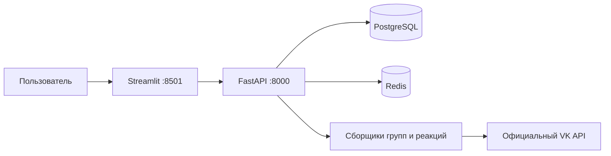

# Инструкции и техническая карта проекта

## Назначение и границы

Учебный проект старшей школы: по теме поиска показать статистику найденной аудитории VK.
Пользователь работает через Streamlit; FastAPI собирает данные через официальный API,
сохраняет текущие профили и связи в PostgreSQL и строит агрегаты. Redis ускоряет поиск
готового результата и подсказок. Главный приоритет — понятный код и честные ограничения данных.

MVP включает участников найденных сообществ, лайки и репосты найденных постов;
сценарии можно объединять. Общий размер — число уникальных доступных профилей в выборке,
а не оценка всех интересующихся темой пользователей VK и не рекламный охват.
Загрузка сегмента в рекламный кабинет, размещение рекламы, комментарии и LLM пока не реализованы.

## Рабочие правила

- Агентные планы, решения, ограничения и будущие заметки вести в этом единственном AGENTS.md.
  Не создавать дополнительные TODO.md, PLAN.md, исследовательские отчёты и подобные файлы.
  README.md предназначен людям: простые объяснения, запуск, ограничения и план развития.
- Писать просто: небольшие функции и классы по назначению, без очередей, микросервисов
  и дополнительных абстракций без конкретной необходимости.
- Автор коммитов только для этого репозитория: `esbulgakova <bulgakovae353@gmail.com>`.
  Пользователь разрешил локальные ветки, коммиты и слияние готовой работы в main.
  Не менять глобальный Git-профиль. Наличие remote не означает проверенный доступ к push.
- Не выводить токены, пароли, содержимое .env, полные VK error payload или HTTP request bodies.
  Не коммитить .env, данные БД, виртуальные окружения, логи с профилями и ключами.
- Использовать только разрешённые VK данные. Не обходить закрытые профили/сообщества,
  CAPTCHA, ограничения API и не заменять отказ скрейпингом сайта или чужим токеном.
- Сохранять только признаки MVP: ID, имя, фамилию, пол, дату рождения, город, страну,
  регион, время обновления и происхождение попадания в выборку. Не сохранять весь JSON
  профиля, контакты, религию, политические взгляды и другие ненужные личные признаки.
- API дашборда возвращает агрегаты и сообщества, а не список людей с профилями.
- Для внутренних сервисов рабочего контура Яндекса (wiki.yandex-team.ru, Nirvana,
  Reactor, YT, Arcanum и других) не использовать браузер: пользователь сообщил,
  что доступ через браузер агента не работает. Использовать подключённые MCP,
  официальные API или CLI. Сначала проверить настроенные инструменты и учётные данные
  нужного сервиса; не просить входить через браузер агента. Секреты не выводить.
  При отсутствии прямого доступа сообщить конкретный блокер.

## План работы и порядок будущих изменений

1. Прочитать этот файл и README, проверить состояние репозитория и существующие изменения.
2. При изменении интеграции сверить официальный интерфейс VK и возможность доступа;
   различать спецификацию метода и успешный вызов с конкретным токеном.
3. Уточнить контракт `Collection` и ответ API до изменения фронтенда/хранилища.
4. Реализовать сбор с пагинацией, лимитами, дедупликацией и понятными ошибками.
5. Сохранить данные атомарно; проверить обновление профилей и замену связей запроса.
6. Построить статистику из БД; неизвестные признаки оставить отдельной категорией.
7. Подключить UI без повторного сбора при переключении вида диаграммы или карты.
8. Выполнить относящиеся к изменению тесты; реальные PostgreSQL/Redis проверять отдельно.
9. Обновить README и этот файл по итоговому поведению. Указать непроверенные зависимости
   от внешнего доступа. Не объявлять Docker/VK-интеграцию работающей по одним mock-тестам.

## Архитектура и карта кода



| Файл | Ответственность |
|---|---|
| `backend/app/main.py` | Фабрика FastAPI, валидация запроса, маршруты, безопасные ошибки |
| `backend/app/config.py` | Настройки окружения, лимиты, проверка токена, ключ политики сбора |
| `backend/app/vk.py` | HTTP POST, ограничение частоты, повторы, срок ожидания, проверка ответа |
| `backend/app/collectors.py` | Контракт Collection, три сценария, профили/гео, демоданные |
| `backend/app/service.py` | Нормализация, свежесть, блокировка, upsert, замена связей, дашборд |
| `backend/app/models.py` | SQLAlchemy-таблицы и внешние ключи |
| `backend/app/database.py` | Подключение, создание схемы, включение FK в SQLite-тестах |
| `backend/app/analytics.py` | Возраст, распределения, доли и покрытие признаков |
| `backend/app/cache.py` | Redis с безопасным отказом; ключи подсказок |
| `frontend/app.py` | Поиск, сценарии, подсказки, метрики, диаграммы, карта/таблица |
| `frontend/geo.py` | Точное сопоставление регионов и карта Plotly без внешних тайлов |
| `frontend/data/regions.geojson` | Подготовленные границы регионов и сведения об источнике |
| `compose.yaml` | Четыре основных сервиса и отдельный тестовый профиль |
| `tests/` | Существенные проверки API, БД, сборщика, статистики и географии |

## Контракты и выполнение поиска

- `GET /health`: доступность БД, режим данных, состояние Redis.
  Отказ Redis не делает PostgreSQL-результат недействительным.
- `GET /api/suggestions?q=...`: до восьми уникальных ранее собранных тем по префиксу;
  источником служит БД, Redis хранит список 30 секунд. Это подсказки поискового ввода.
- `POST /api/search`: `{"query":"фотография","modes":["groups","likes","reposts"]}`.
  Нужен минимум один сценарий; тема после нормализации имеет длину 2–200 символов.
- Ответ: тема/режимы, `collected_at`, `expires_at`, `cache_hit`, `limited`, `complete`,
  `warnings`, `total_users`, распределения `gender`, `age`, `geography`, `coverage`,
  справочник найденных `groups` и количества уникальных пользователей по `sources`.
- 409 означает уже выполняющийся сбор; 502 — безопасную ошибку сборщика/VK;
  503 — ошибку БД; 422 — невалидный запрос. Сообщения не должны содержать секреты.
- `Collection.users` — словарь ID → разрешённые поля профиля; `groups` — ID → сообщество;
  `memberships` — множество `(group_id,user_id)`; `evidence` — `(user_id,source,source_id)`.
  `source_id` для группы — её ID, для реакции — строка `owner_id_post_id`.
- `complete=False` означает сбой части сбора. `limited=True` означает ограниченный
  объём выборки; это не обязательно технический сбой. Успешный пустой ответ допустим.
- Сначала собираются ID, затем `users.get` получает профили пакетами до 1000.
  Деактивированные и закрытые профили исключаются, отрицательные ID не считаются людьми.
  Пользователь из нескольких источников учитывается один раз в общем размере;
  количества по источникам пересекаются, их нельзя складывать как уникальную аудиторию.
- Streamlit хранит ответ в session state. Переключение диаграммы/карты использует этот
  ответ и не запускает новый POST. Новый сбор запускается кнопкой поиска.

## Реляционная модель и обновление

| Таблица | Ключ и назначение |
|---|---|
| `users` | PK `(mode,id)`, последняя информация о профиле |
| `communities` | PK `(mode,id)`, последняя информация о сообществе |
| `searches` | PK `id`, уникальный `key`, тема/режимы/время сбора/срок/предупреждения |
| `search_users` | PK `(search_id,user_id)`, FK к поиску и `(mode,user_id)` к users |
| `search_communities` | PK `(search_id,group_id)`, FK к поиску и `(mode,group_id)` к communities |
| `memberships` | PK `(search_id,group_id,user_id)`, FK к обеим связующим таблицам |
| `evidence` | Уникальность `(search_id,user_id,source,source_id)`, FK к search_users |

- `mode=demo/vk` входит в ключи профилей и сообществ: вымышленные данные не перезаписывают реальные.
- Для успешного обновления upsert заменяет известные признаки текущими; отсутствующее
  в новом разрешённом профиле поле очищается, а не сохраняет старое значение бессрочно.
- В одной транзакции обновляются профили/сообщества и целиком заменяются связи этого
  запроса. Удаляются сначала memberships/evidence, затем связующие строки; вставка
  идёт от родителей к детям. Связи других запросов сохраняются.
- Нет истории версий профилей и снимков: в БД хранится текущая строка профиля и одна
  выборка на ключ запроса. Новые люди добавляются, повторные ID не размножаются.
- Профиль общий для запросов одного режима: новое наблюдение в теме B может обновить
  его признаки в дашборде темы A. `collected_at` обозначает время сбора состава темы,
  а не отдельный неизменяемый снимок каждого признака.
- При полном сбое сборщик выбрасывает CollectionError; транзакция не заменяет старую выборку.
- При неполном обновлении существующей полной выборки сервис ничего не перезаписывает:
  возвращает прежний дашборд с `complete=False`, старой датой и предупреждением.
  Срок свежести не продлевается, следующий поиск повторяет попытку обновления.
- Первый неполный результат можно сохранить и показать, но его TTL равен нулю.
  Ограниченная лимитами, но технически успешная выборка может иметь обычный TTL.
- `create_all` создаёт отсутствующие таблицы, но не мигрирует существующие колонки.
  При развитии схемы подготовить явную миграцию; не удалять пользовательский volume для удобства.

## Свежесть, кэш и конкурентный доступ

- Нормализация: Unicode NFKC → casefold → `ё` в `е` → схлопывание пробелов.
  « ФОТОГРАФИЯ » и «фотография» совпадают. Синонимы и разные словоформы пока не объединяются.
- Ключ поиска: SHA-256 от нормализованной темы, отсортированного множества сценариев,
  режима demo/vk и `policy_key`. Последний учитывает лимиты, окно постов, версию VK API
  и номер схемы политики. Секрет токена в ключ не включать.
- По умолчанию данные свежие 86400 секунд от завершения сбора, а не до полуночи.
  Свежесть каждый раз проверяется по `searches.expires_at` в PostgreSQL.
- Redis хранит соответствие ключ → ID поиска, не готовый дашборд. Очистка Redis
  не вызывает новый VK-сбор, если выборка в БД ещё свежая. Агрегаты строятся из БД.
- Значение, дата или наличие ключа в Redis не заменяют проверку БД.
- Один Uvicorn worker. В процессе действует неблокирующий threading.Lock, а в PostgreSQL
  — `pg_try_advisory_xact_lock(724191854)` на время всей транзакции сбора.
  Это защищает от одновременно начатых сборов и лишних обращений к VK.
  Уже свежие результаты можно читать во время другого сбора.
- Не увеличивать число workers/реплик без отдельного решения по общей квоте VK,
  блокировкам и длительным запросам. В MVP нет фоновой очереди и сохранённых заданий.

## VK API: проверенные факты и границы проверки

Исследование выполнено 1 ноября 2026. `dev.vk.com` и `dev.vk.ru` в среде агента
не открывались. Параметры сверены по официальной VKCOM/vk-api-schema, версия 5.199,
commit `333481bd082ad747d4873ef4a77f9247097eeef0` от 14 апреля 2025.
Это официальная спецификация 2025 года, НЕ живое подтверждение доступности в 2026.
Без пользовательского токена реальные методы не проверены. Не превращать эту оговорку
в утверждение, что методы гарантированно доступны либо окончательно отключены.

| Метод | По схеме: тип ключа и границы | Применение |
|---|---|---|
| `groups.search` | user; count ≤1000, доступны первые 1000 результатов | Открытые сообщества среди первых MAX_GROUPS результатов |
| `groups.getMembers` | user/group/service; count ≤1000, offset | Участники, размер группы из response.count |
| `users.get` | user/group/service; ≤1000 user_ids | Разрешённые признаки найденных людей |
| `newsfeed.search` | user/service; count ≤200, start_from/next_from | Посты в явном временном окне |
| `likes.getList` | user/service; count ≤1000, offset, filter=likes/copies | ID лайкнувших и поделившихся |
| `database.getCities` | user; count ≤1000; возвращает текст region/area | Попытка уточнить регион с точным совпадением city_id |
| `database.getCitiesById` | user/service; ≤1000 city_ids; id,title | НЕ источник гарантированных региона/координат |
| `wall.getReposts` | user/service; count ≤1000; posts/profiles/groups | Изученная альтернатива; в MVP не вызывается |
| `wall.search` | user/service; domain/query, count ≤100 | Будущий поиск на заданной стене |
| `wall.getComments` | user/service; count ≤100; отдельная пагинация веток | План развития |

- Для likes.getList у группы `owner_id` отрицательный. Это ID владельца записи,
  а не знак пользовательских ID в результирующей аудитории.
- В newsfeed.search явное окно определяется POST_SEARCH_DAYS; дефолт VK без start_time
  по схеме — 24 часа. Повторяющийся курсор/страница останавливает обход с предупреждением.
- Структура ответа проверяется: неожиданный JSON не должен превращаться в успешную пустую аудиторию.
- VkClient передаёт ключ в теле POST, не в URL. Использует общий интервал 0.36 секунды,
  максимум три попытки для временных сетевых ошибок/429/5xx/кодов 6 и 10, общий deadline сбора.
  Это собственные настройки MVP, а не гарантия действующих квот VK.
- Ошибки прав/авторизации, CAPTCHA и исчерпание лимита не обходятся. Сообщение создаётся
  локально: raw error_msg/request_params могут содержать токен. Не логировать их.
- Чтобы подключиться без существующего приложения, начать с официального создания
  приложения VK ID и проверить выдаваемые VK права именно на нужные методы.
  Обычная регистрация и вход через VK ID не гарантируют полный пользовательский VK API ключ.
  Если нужного доступа нет в кабинете, его может предоставить только VK; деморежим остаётся доступен.
  Не предлагать старые implicit-grant ссылки с чужими app_id или сторонние генераторы токенов.

## География и достоверность диаграмм

- У `users.city` гарантирована только пара id/title. В текущем users_fields enum
  отсутствует country, хотя описание users.get его перечисляет. Сборщик запрашивает
  country и при ошибке 100 повторяет users.get без него; неизвестные страны остаются неизвестными.
- В схеме database.getCities нет country_id; код передаёт этот параметр для совместимости
  с документировавшимся ранее интерфейсом. Это best effort, требующий живой проверки.
  Совпадение названия города недостаточно: регион берётся только при совпадении VK city_id.
- Не обещать полную карту по профилям. Неизвестные страны/регионы остаются в таблице.
  Покрытие города (`coverage.geography`) и доля, сопоставленная с картой областей, различаются.
- Карта использует локальный Natural Earth admin-1 GeoJSON; источник/лицензия записаны
  в его metadata. Это схематические границы из источника, а не сервис актуальных границ.
- Поддержан набор RU/BY/UA/KZ/KG/UZ/TJ/TM/MD/AM/AZ/GE; его нельзя называть точным текущим
  юридическим составом СНГ. Географическое покрытие включает соседние страны.
- Регион сопоставляется только по точному нормализованному алиасу. Без страны допустим
  лишь единственный однозначный регион; явная другая страна не игнорируется.
  Город используется как регион только для соответствующей административной единицы
  типа City/Independent City/Federal City при известной стране. Не назначать столицу неизвестным людям.
- Пол: 0/отсутствие → «Не указан», 1 → женский, 2 → мужской. Без года рождения
  возраст неизвестен; невозможные даты/возраст вне 0–110 также неизвестны.
  Проценты считаются от всей выборки, включая неизвестные значения; округление допустимо.

## Проверки и локальный запуск

Основной путь из корня репозитория (Python в контейнерах 3.12):

```bash
cp .env.example .env
docker compose up --build -d
docker compose ps
docker compose logs --tail=100 backend frontend
docker compose down
```

UI: http://localhost:8501, документация API: http://localhost:8000/docs.
Порты опубликованы только на 127.0.0.1; PostgreSQL/Redis наружу не опубликованы.
`docker compose down` сохраняет БД; `down -v` удаляет данные и требует осознанного решения.

```bash
python3.12 -m venv .venv
.venv/bin/python -m pip install -r requirements-dev.txt
.venv/bin/python -m pytest -q -m "not integration"
.venv/bin/python -m ruff check backend frontend tests
docker compose --profile test run --build --rm tests
```

Тестовый Compose поднимает отдельные postgres-test/redis-test, не рабочую БД.
Интеграционный тест создаёт уникальную схему PostgreSQL и удаляет только её.
Без TEST_DATABASE_URL и TEST_REDIS_URL реальная интеграция пропускается — skip не равен pass.
Текущая локальная среда разработки агента также может использовать `.venv312` вместо `.venv`.

Проверять важные инварианты: 24 часа и Redis outage; нормализацию; разделение режимов/
сценариев/политик; upsert и замену связей; сохранение полной выборки при сбое;
дедупликацию; неизвестные возраст/гео; токен вне URL/ошибок; пагинацию и квоты;
один сбор; переключение графика без нового POST. Не добавлять тесты ради снимков оформления.
Не считать наличие этих команд доказательством выполненного Docker, PostgreSQL или живого VK теста.

## Итог проверок 1 ноября 2026

- Финальный `pytest -q`: **50 passed, 1 skipped**; пропуск — интеграция без заданных адресов сервисов.
  `ruff check` завершён без замечаний.
- `tests/test_integration.py` отдельно: **1 passed** на настоящих PostgreSQL 16.6 и Redis 7.4.2,
  запущенных из временного тестового окружения в `/private/tmp`; рабочая БД не использовалась.
- Streamlit AppTest прошёл также с настоящими HTTP-запросами к запущенному FastAPI.
- `compose.yaml` разобран как YAML и проверен по официальной JSON Schema compose-spec;
  проверены зависимости сервисов, пути Dockerfile, тестовый профиль и привязка портов к localhost.
- Docker не установлен: образы не собирались, полный Compose-контур не запускался.
  Скриншот в браузере не получен: CUA вернул `browsers=[]`, in-app browser недоступен.
- `git ls-remote` успешно прочитал GitHub. `git push --dry-run` не прошёл: HTTPS-клиент
  не получил Username при отключённом интерактивном запросе. Доступ для push пока не настроен;
  содержимое токенов не выводилось. Настоящего push не было.
- Живые вызовы VK с пользовательским токеном не проверены; демоданные не подтверждают доступ к API.

## План развития

1. Проверить права собственного приложения и живой небольшой поиск VK, зафиксировать
   реальные ошибки и поддержанные поля без секретов. Уточнить географический справочник.
2. Добавить поиск внутри выбранных сообществ и расширить прозрачные показатели покрытия.
3. Разбирать комментарии/ветки через wall.getComments; хранить только нужные признаки,
   учитывать контекст, отрицания и неоднозначность интереса.
4. Предлагать LLM-расширение темы: варианты запроса показывать пользователю; не отправлять
   в модель профили и контакты. Ключ кэша должен учитывать утверждённые запросы и версию политики.
5. Отдельно спроектировать законное создание рекламных сегментов через поддерживаемый
   рекламный API и его разрешения. Нынешний дашборд не является готовым сегментом кабинета.
6. При росте нагрузки добавить миграции, задания со статусом, аутентификацию и политику
   удаления данных; не вводить эти компоненты заранее ради архитектурной сложности.

## Первичные источники

- [VK API schema и версия](https://github.com/VKCOM/vk-api-schema).
- [Методы групп](https://github.com/VKCOM/vk-api-schema/blob/333481bd082ad747d4873ef4a77f9247097eeef0/groups/methods.json).
- [Поиск постов](https://github.com/VKCOM/vk-api-schema/blob/333481bd082ad747d4873ef4a77f9247097eeef0/newsfeed/methods.json).
- [Лайки и filter=copies](https://github.com/VKCOM/vk-api-schema/blob/333481bd082ad747d4873ef4a77f9247097eeef0/likes/methods.json).
- [Стена и комментарии](https://github.com/VKCOM/vk-api-schema/blob/333481bd082ad747d4873ef4a77f9247097eeef0/wall/methods.json).
- [Поля профиля](https://github.com/VKCOM/vk-api-schema/blob/333481bd082ad747d4873ef4a77f9247097eeef0/users/objects.json).
- [Методы географии](https://github.com/VKCOM/vk-api-schema/blob/333481bd082ad747d4873ef4a77f9247097eeef0/database/methods.json), [ответы](https://github.com/VKCOM/vk-api-schema/blob/333481bd082ad747d4873ef4a77f9247097eeef0/database/responses.json), [объекты](https://github.com/VKCOM/vk-api-schema/blob/333481bd082ad747d4873ef4a77f9247097eeef0/database/objects.json).
- [Коды ошибок](https://github.com/VKCOM/vk-api-schema/blob/333481bd082ad747d4873ef4a77f9247097eeef0/errors.json).
- [Официальный VK ID SDK](https://github.com/VKCOM/vkid-web-sdk) и [создание приложения](https://id.vk.ru/about/business/go/docs/ru/vkid/latest/vk-id/connection/create-application).
- [OAuth в официальном VK PHP SDK](https://github.com/VKCOM/vk-php-sdk#4-authorization): справка о flow, не обещание доступности прав новому приложению.
