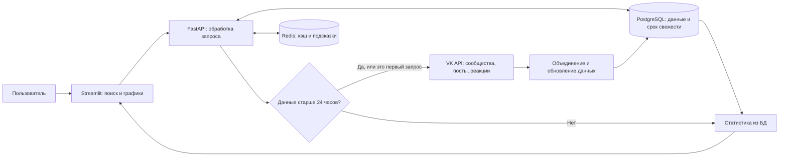

# Аудитория VK

Учебный проект: вводим тему, например «велосипеды», выбираем источники и получаем дэшборд потенциальной аудитории. В нём видны количество найденных людей, пол, возраст и география.

**Для первого запуска токен не нужен.** По умолчанию включён демонстрационный режим с вымышленными данными. Для настоящего сбора понадобится приложение VK и ключ с разрешёнными методами API. Получение такого доступа зависит от VK; регистрация приложения сама по себе его не гарантирует.

## Что уже умеет проект

- Искать тематические сообщества и собирать доступных участников.
- Искать публикации по теме и собирать пользователей, поставивших лайк или сделавших репост. Сценарии можно включать вместе или отдельно.
- Объединять людей без дублей и сохранять результат в PostgreSQL.
- Показывать число уникальных пользователей, распределение пола и возраста. Круговые диаграммы переключаются в столбчатые без повторного сбора.
- Показывать региональную карту СНГ и соседних стран, таблицу с количеством и долей пользователей, выгрузку этой таблицы в CSV.
- Подсказывать недавние темы при вводе и повторно использовать свежую выборку до 24 часов.

Это **аналитический MVP**. Он пока не создаёт аудиторию в рекламном кабинете, не запускает объявления и не экспортирует списки личных профилей. Участие в сообществе или реакция на публикацию — приблизительный признак интереса, а не подтверждение намерения купить товар.

## Как запустить

Потребуется [Docker Desktop](https://docs.docker.com/desktop/). Установите и запустите его; Docker Compose входит в поставку. Python и базу данных отдельно устанавливать не нужно.

Проверить установку можно командами `docker version` и `docker compose version`. В первой должны быть разделы **Client** и **Server**. Отдельно устанавливать Compose не нужно; команда проекта пишется с пробелом: `docker compose`.

Если на macOS Docker Desktop установлен, но терминал сообщает `docker: command not found`, проверьте пользовательскую установку команд в `~/.docker/bin`. Для неё добавьте в `~/.zshrc` строку:

```bash
export PATH="$HOME/.docker/bin:$PATH"
```

Затем откройте новое окно терминала или выполните `source ~/.zshrc`. Подробнее — [официальная инструкция Docker для macOS](https://docs.docker.com/desktop/setup/install/mac-permission-requirements/).

В терминале:

```bash
cd /Users/bulgakovdmitr/Documents/projects/target_audience_dashboard
cp .env.example .env
docker compose up --build -d
```

`cp .env.example .env` нужен только при первом запуске: не выполняйте его поверх уже заполненного файла с токеном. Первая сборка скачает образы и библиотеки и займёт несколько минут.

Откройте **[приложение](http://localhost:8501)**, введите «велосипеды» и нажмите «Найти аудиторию». На странице будет заметная отметка демонстрационного режима.

Дополнительные адреса: [документация API](http://localhost:8000/docs), [проверка работоспособности](http://localhost:8000/health).

Полезные команды:

```bash
docker compose ps
docker compose logs --tail=100 backend frontend
docker compose down
```

`down` останавливает приложение, сохраняя БД в Docker-томе. Чтобы полностью удалить собранные данные, есть отдельная команда **`docker compose down -v`** — она удаляет и том базы данных.

После изменения кода или `.env` снова выполните `docker compose up --build -d`. Простого `restart` недостаточно для применения изменённых переменных окружения.

Приложение доступно только на этом компьютере. PostgreSQL и Redis не открывают порты наружу. Вход по логину не реализован: перед размещением в интернете потребуются авторизация и настройка доступа.

## Как подключить настоящие данные VK

Вход через VK ID уже встроен в интерфейс. Сервис сам получает пользовательский токен и обновляет его при обращении к VK. **Сервисный ключ приложения** нужен один раз для настройки; он отличается от пользовательского токена, который появится после входа.

1. В [кабинете VK ID](https://id.vk.ru/about/business/go/) создайте своё приложение платформы **Web** и подтвердите профиль VK Бизнес ID по правилам кабинета. Укажите базовый домен `localhost` и доверенный redirect URL `http://localhost`, без порта.
2. В ключах приложения выберите уровень **«Конфиденциальное»**. В поле **«IP-адрес сервера»** добавьте внешний IP, с которого компьютер с Docker выходит в интернет. Это не `127.0.0.1` и не адрес контейнера. Если VPN или провайдер изменит этот адрес, обновите его в VK. Для начала оставьте базовые доступы; почта и телефон проекту не нужны.
3. Запишите **ID приложения** в `VK_APP_ID` локального `.env` и выполните `docker compose up --build -d`. Порт 80 должен быть свободен: Compose направляет `http://localhost` в обработчик входа FastAPI. Дэшборд по-прежнему открывается на `http://localhost:8501`.
4. В дэшборде откройте слева **«Подключение VK → Настройка приложения VK ID»**, вставьте **сервисный ключ доступа** из кабинета и нажмите **«Сохранить ключ»**. Защищённый ключ (`client_secret`) здесь не используется. Поле с ключом очищается после отправки.
5. Нажмите **«Войти через VK ID»**, затем кнопку входа на открывшейся локальной странице. Войдите в свой аккаунт на сайте VK и разрешите базовый доступ. После возврата дэшборд проверит состояние подключения и выберет **«Данные VK»**. Если осталась старая вкладка, нажмите **«Обновить подключение»**.
6. Нажмите **«Проверить доступ к поиску»**. Эта проверка вызывает только поиск одного сообщества, без сбора участников. Затем попробуйте небольшой поиск по сообществам, после него — лайки. Вход сам по себе ещё не подтверждает доступ ко всем методам API.

Текущая интеграция использует современный обмен кода с PKCE и базовый scope `vkid.personal_info`. Для `groups.search` нужен пользовательский токен; сервисный ключ непосредственно для этого поиска не подходит. Дополнительные права `groups`, `wall`, `offline` не запрашиваются автоматически. При отказе метода нужно уточнять доступ конкретного приложения у VK. [Создание и настройки приложения](https://id.vk.ru/about/business/go/docs/ru/vkid/latest/vk-id/connection/create-application), [схема авторизации](https://id.vk.ru/about/business/go/docs/ru/vkid/latest/vk-id/connection/start-integration/how-auth-works/auth-flow-web).

Пользовательский токен действует один час. Токен обновления действует до 180 дней и используется один раз: сервер сохраняет новую пару вместо старой. После неоднозначного сетевого сбоя при обновлении приложение попросит войти повторно, чтобы не использовать старый ключ второй раз. Кнопка **«Отключить VK»** удаляет локальное подключение и пытается завершить сессию в VK; если VK не подтвердит операцию, интерфейс сообщит об этом. [Правила токенов обновления](https://id.vk.ru/about/business/go/docs/ru/vkid/latest/vk-id/connection/tokens/refresh-token).

Ключ и токены хранятся в отдельном Docker-томе `vk_auth_data`, в файле, доступном пользователю backend. Они переживают обычный перезапуск контейнера; UI не получает их обратно. Не отправляйте ключи в чат, GitHub или на скриншотах. Сервисный ключ также можно задать через `VK_SERVICE_TOKEN` в `.env`, но для обычной работы достаточно интерфейса. `.env` исключён из Git и Docker-контекста; вывод `docker compose config` с заполненными секретами не публикуйте.

Если у вас уже есть действующий пользовательский токен, можно указать его в `VK_TOKEN` и перезапустить контейнеры. Это ручной вариант: без токена обновления его срок не продлевается. После успешного входа через VK ID используется новое подключение. Для проверки проекта без доступа VK всегда доступен переключатель **«Демонстрация»**.

**Репосты доступны не для любой найденной публикации.** Согласно [likes.getList](https://dev.vk.ru/ru/method/likes.getList), список `filter=copies` возвращается только редактору/администратору сообщества либо владельцу личной стены.

Официальные страницы VK и VK ID прочитаны 1–2 ноября 2026 года. Старые пользовательские Implicit Flow и Authorization Code Flow отключены с 25 июня 2024 года; современная схема VK ID с PKCE продолжает использовать обмен кода. [Правила ключей VK](https://dev.vk.ru/ru/api/access-token/getting-started). Проверки кода используют имитацию ответов VK; реальный вход и разрешения проверяются после подключения собственного аккаунта. Технические детали — в [AGENTS.md](AGENTS.md).

## Как читать дэшборд

**Количество людей** — число уникальных доступных профилей в собранной выборке. Это не полный размер интересующейся темой аудитории VK и не прогноз рекламного охвата. Один человек может попасть через несколько источников, поэтому их отдельные счётчики нельзя складывать.

**Пол и возраст.** Закрытые и деактивированные профили не собираются. Если пол не указан или в дате рождения нет года, пользователь попадает в «Не указан». Эти люди остаются в знаменателе процентов. Возраст рассчитывается на день просмотра.

**География.** Регион берётся из доступного справочника VK только при совпадении ID города. По одному названию города область не угадывается. На карте отображаются лишь однозначно сопоставленные регионы; остальные записи остаются в таблице. Доля сопоставленных показана рядом с картой. Таблица умеет группировать записи по стране и региону и показывать города подробнее.

Карта содержит 307 географических единиц 12 стран: России, Беларуси, Казахстана, Армении, Азербайджана, Кыргызстана, Молдовы, Таджикистана, Туркменистана, Узбекистана, а также Украины и Грузии. Это географическое покрытие, а не список действующих членов СНГ. Границы из [Natural Earth](https://www.naturalearthdata.com/about/terms-of-use/) схематические и статические; новые или несопоставленные регионы могут отсутствовать. Карта работает с локальным файлом, без внешних картографических ключей и тайлов.

В `.env` можно менять размер выборки:

| Настройка | По умолчанию | Значение |
|---|---:|---|
| `MAX_GROUPS` | 3 | Первые найденные сообщества |
| `MAX_MEMBERS_PER_GROUP` | 500 | Участники одного сообщества |
| `MAX_POSTS` | 10 | Найденные публикации |
| `MAX_REACTIONS_PER_POST` | 200 | Пользователи каждого вида реакции на публикацию |
| `MAX_USERS` | 3000 | Общий предел уникальных ID перед загрузкой профилей |
| `MAX_CITY_LOOKUPS` | 20 | Уточнения регионов разных городов за сбор |
| `POST_SEARCH_DAYS` | 30 | За сколько последних дней искать публикации |

Первые результаты поиска и участники по ID — не случайная статистическая выборка. При включении всех сценариев общий лимит заполняется в порядке «сообщества → лайки → репосты». Увеличение лимитов требует больше запросов и времени, но не гарантирует полноту: у VK есть собственные ограничения и настройки приватности. На один сбор отведено до нескольких минут. При параллельном новом поиске приложение попросит дождаться текущего.

## Что происходит внутри

| Компонент | Простыми словами |
|---|---|
| Streamlit | Веб-страница с поиском и графиками |
| FastAPI | Сервер: принимает запрос, собирает данные, считает статистику |
| PostgreSQL | Постоянное хранилище людей, сообществ и найденных связей |
| Redis | Быстрый вспомогательный кэш запросов и подсказок |
| Docker Compose | Запускает эти четыре компонента вместе |



1. У запроса убираются лишние пробелы, регистр и различие «ё/е». Например, «  ВЕЛОСИПЕДЫ » и «велосипеды» используют одну выборку. Синонимы вроде «велосипеды» и «велоспорт» пока считаются разными темами.
2. Ключ учитывает тему, выбранные сценарии, режим данных, лимиты сбора и подключение VK. Выборка только по группам не подменяет выборку по лайкам. Демоданные и реальные данные разделены.
3. Если результат свежий, сервер строит статистику из БД без обращений к VK. Redis можно очистить: срок свежести хранится в PostgreSQL и не потеряется.
4. Через 24 часа **при следующем поиске** запускается новый сбор. Фонового обновления по расписанию нет.
5. Пользователь хранится один раз на режим данных и обновляется по VK ID. Пропавшее поле не заменяется старым значением. Связи конкретного запроса заменяются целиком. Исторические версии выборок не создаются; профили, найденные в других запросах, остаются в общей базе.
6. При ошибке обновления прежняя полная выборка сохраняется. Неполный первый результат не считается свежим на 24 часа: следующий поиск повторяет попытку. При полном отказе API показывается ошибка, а не успешный нулевой охват.

Сохраняются только необходимые доступные поля профиля: ID, имя, фамилия, пол, дата рождения, город, страна и регион. Контакты, переписки и произвольные «все признаки» не собираются. API интерфейса отдаёт агрегаты, без списка пользователей.

## Структура проекта

```text
backend/app/       сервер, работа с VK, БД, кэш и расчёты
frontend/          интерфейс Streamlit и локальные границы регионов
tests/             важные проверки логики, API и интеграций
compose.yaml       запуск приложения и отдельного тестового контура
.env.example       пример настроек без секретов
README.md          описание и инструкция для человека
AGENTS.md          подробный технический план и заметки для агентов
```

## Проверки

Проверяются дедупликация, обновление профилей и связей, 24-часовой кэш, пропуски в возрасте, обработка ошибок VK, карта, HTTP API и переключения интерфейса. Ответы VK в тестах искусственные: тесты не требуют токена и не обращаются к реальным профилям.

Полный набор с отдельными настоящими PostgreSQL и Redis:

```bash
docker compose --profile test run --build --rm tests
docker compose --profile test stop postgres-test redis-test
```

Тестовая БД отдельная, основной том данных не затрагивается.

Для разработки без Docker можно создать окружение Python 3.11+ и выполнить быстрые проверки:

```bash
python3 -m venv .venv
source .venv/bin/activate
python -m pip install -r requirements-dev.txt
python -m pytest -q
python -m ruff check .
```

Без `TEST_DATABASE_URL` и `TEST_REDIS_URL` тест настоящих PostgreSQL/Redis пропускается; остальные используют временную SQLite и имитацию Redis. Основной способ запуска приложения — Docker Compose.

На 2 ноября 2026 года все четыре Docker-сервиса успешно запущены. В тестовом контейнере прошли **83 теста без пропусков**, включая настоящие PostgreSQL и Redis; Ruff также прошёл. Проверены защита входа и обновления токенов на имитации VK, разделение режимов и аккаунтов, сохранение дашборда при временной ошибке статуса и корректность HTTP-заголовков. На работающих контейнерах проверены поиск 165 демопрофилей, повторное использование выборки, статус приложения и возврат через порт 80. Панель подключения открыта и осмотрена в браузере. **Реальный вход VK и доступ к методам требуют сервисного ключа и проверки с вашим аккаунтом.**

## Если что-то не работает

| Симптом | Что проверить |
|---|---|
| `docker: command not found` | Установлен ли Docker Desktop |
| `Cannot connect to the Docker daemon` | Запущен ли Docker Desktop |
| Страница ещё не открывается | `docker compose ps`: подождите сборку и готовность сервисов |
| Порт 80, 8501 или 8000 занят | Освободите занятый порт. Для локального входа VK нужен именно порт 80; произвольно менять redirect-порт нельзя |
| Ошибка входа или доступа VK | Конфиденциальный тип приложения, сервисный ключ, разрешённый внешний IP; затем повторный вход и «Проверить доступ к поиску» |
| Найдено мало людей | Лимиты выборки, закрытые данные и доступность выбранного метода |
| На карте мало регионов | VK мог не вернуть страну или регион; проверьте долю сопоставленных и таблицу |
| Redis недоступен | Поиск продолжает работать через PostgreSQL, но может быть медленнее |
| База не принимает пароль после его смены | Пароль созданной БД сам не меняется от редактирования `.env`; верните прежний или измените его в БД |

## Что можно добавить дальше

1. Комментарии к публикациям: отдельный сценарий, обход ответов в ветках, определение интересов по текстам. Комментарий сам по себе не означает согласия с публикацией.
2. LLM для расширения темы: предложить синонимы и уточнения, дать человеку проверить их перед сбором. Начать с текстов запросов, без отправки личных профилей модели.
3. Поиск внутри выбранных сообществ через `wall.search`, когда глобальный поиск публикаций недоступен.
4. Фоновую очередь с прогрессом для больших выборок, миграции БД и управление сроком хранения данных.
5. Авторизацию, сохранённые проекты и интеграцию с разрешёнными механизмами VK Рекламы. Это отдельная задача с собственными правилами доступа.

Лицензия кода — [Apache 2.0](LICENSE). Данные границ Natural Earth — public domain; источник и версия записаны внутри `frontend/data/regions.geojson`.
